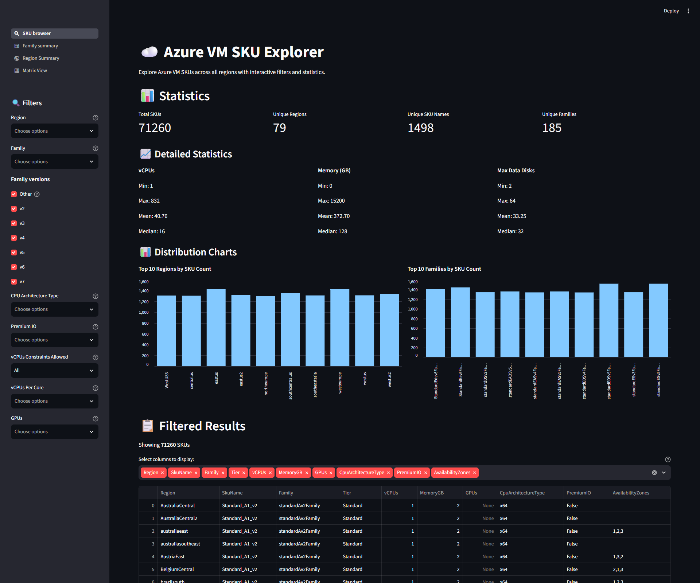
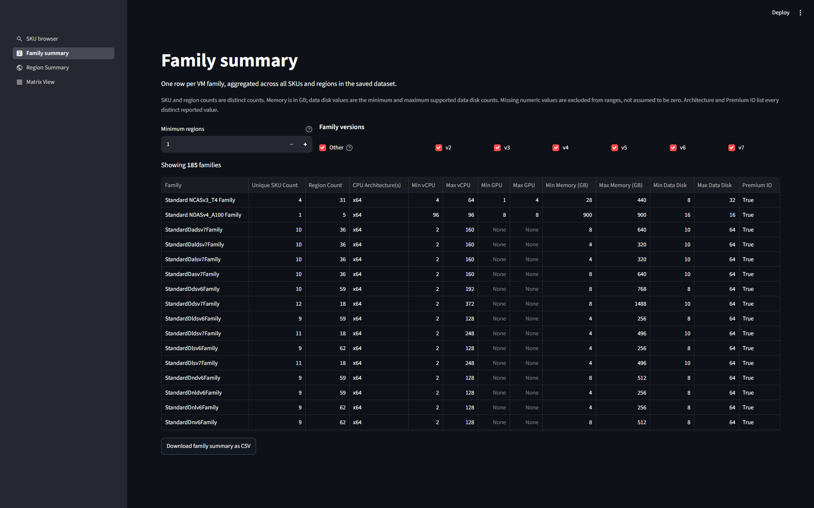
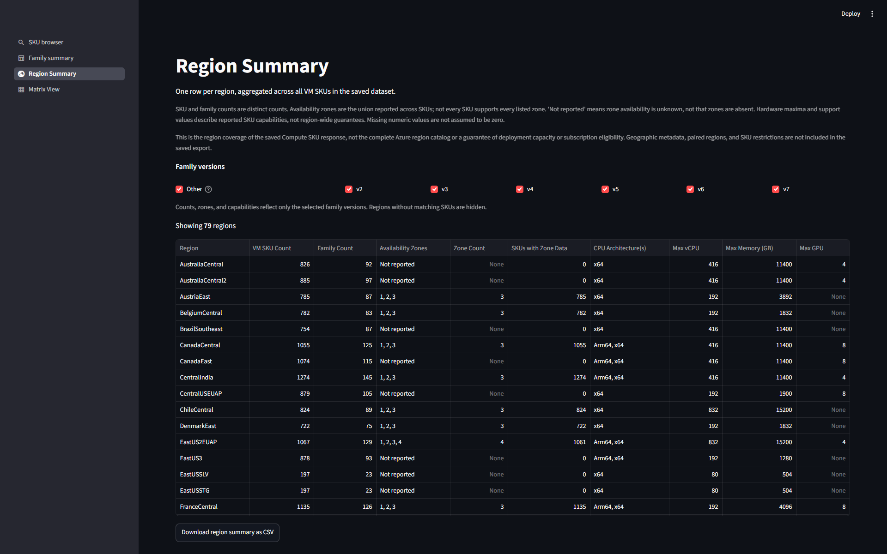
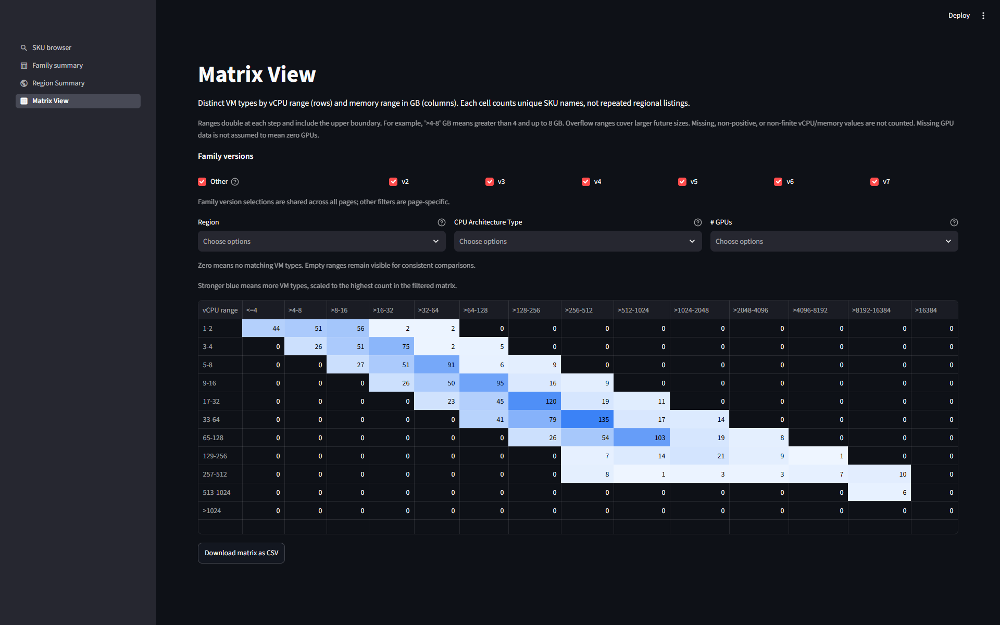

# Azure VM SKU Explorer

This project provides tools to fetch and explore Azure Virtual Machine SKUs across all regions using the Azure REST API. It includes a data collection script and an interactive Streamlit dashboard for visualization.

## Features

- Fetch all Azure VM SKUs across all regions
- Export data to both CSV and Parquet formats
- Interactive Streamlit dashboard with filtering capabilities
- Four report pages: SKU browser, Family summary, Region Summary, and Matrix View
- Shared family-version selections across reports
- Distinct SKU aggregation, region coverage, and a vCPU/memory heatmap
- Detailed statistics and visualizations
- Support for vCPU, memory, GPU, disk, and architecture filtering

## Prerequisites

- **uv** installed ([installation instructions](https://docs.astral.sh/uv/getting-started/installation/))
- **Python 3.13+** required; the project pins Python 3.13 in `.python-version`, and uv can install it automatically
- **Azure Subscription** with appropriate permissions
- **Azure App Registration** (Service Principal) with Reader role

## Setup

### 1. Create an Azure App Registration

Create an app registration in Azure Entra ID (formerly Azure AD) to obtain credentials:

1. Navigate to **Azure Portal** → **Entra ID** → **App registrations**
2. Click **New registration**
3. Enter a name (e.g., "VM SKU Reader")
4. Click **Register**
5. Note the **Application (client) ID** and **Directory (tenant) ID**
6. Go to **Certificates & secrets** → **New client secret**
7. Create a secret and **copy the value immediately** (it won't be shown again)

### 2. Grant Permissions to the Subscription

Assign the Reader role to your app registration:

```azurecli
az role assignment create \
  --assignee <YOUR_APP_CLIENT_ID> \
  --role Reader \
  --scope /subscriptions/<YOUR_SUBSCRIPTION_ID>
```

Verify the role assignment:

```azurecli
az role assignment list --assignee <YOUR_APP_CLIENT_ID>
```

---

Or use the a powershell script for the creation and role assignment all in one:
```powershell
# App name
$appName = "MyAppRegistration"

# Create App Registration
$app = New-AzADApplication -DisplayName $appName

# Create Service Principal
$sp = New-AzADServicePrincipal -ApplicationId $app.AppId

# Create Client Secret (valid for 2 years)
$secret = New-AzADAppCredential `
    -ApplicationId $app.AppId `
    -StartDate (Get-Date) `
    -EndDate (Get-Date).AddYears(2)

# Give Azure AD a few seconds to replicate the Service Principal
Start-Sleep -Seconds 20

# Assign Reader role on current subscription
$subscriptionId = (Get-AzContext).Subscription.Id

New-AzRoleAssignment `
    -ApplicationId $app.AppId `
    -RoleDefinitionName "Reader" `
    -Scope "/subscriptions/$subscriptionId"

# Output
Write-Host ""
Write-Host "=== App Registration Created ==="
Write-Host "Client ID     : $($app.AppId)"
Write-Host "Tenant ID     : $((Get-AzContext).Tenant.Id)"
Write-Host "Client Secret : $($secret.SecretText)"
Write-Host "Subscription  : $subscriptionId"
Write-Host "Role          : Reader"
```

### 3. Configure Environment Variables

Create a `.env` file in the project root with your Azure credentials:

```ini
AZURE_TENANT_ID=<YOUR_TENANT_ID>
AZURE_CLIENT_ID=<YOUR_APP_CLIENT_ID>
AZURE_CLIENT_SECRET=<YOUR_CLIENT_SECRET>
AZURE_SUBSCRIPTION_ID=<YOUR_SUBSCRIPTION_ID>

# Optional: Use custom endpoints (defaults shown)
# AZURE_AUTH_AUTHORITY=https://login.microsoftonline.com
# AZURE_ARM_SCOPE=https://management.azure.com/.default
# AZURE_API_BASE_URL=https://management.azure.com
```

**⚠️ Important:** Never commit the `.env` file to version control. It's already included in `.gitignore`.

### 4. Set Up the Python Environment with uv

Install uv if it is not already available. On Windows:

```powershell
winget install --id astral-sh.uv --exact
```

Open a new terminal after installation, then run the following from the project root on any platform:

```console
uv sync --locked
```

This installs the pinned Python version if needed, creates `.venv`, and installs the exact dependencies from `uv.lock`. No manual virtual environment creation or activation is required: use `uv run` for project commands.

Dependencies are declared in `pyproject.toml`; `uv.lock` records their resolved versions. Keep both files in version control, but do not commit `.venv`.

**Package index:** `pyproject.toml` configures the Microsoft CFS package feed as the default index. Dependency installation requires access to that feed.

## Usage

### Interactive Launcher

```console
uv run --locked python main.py
```

The launcher checks both data files and displays their presence, size, last-modified timestamp, and age compared with the current UTC time. Choose **1** to run the data fetcher, **2** to start the Streamlit SKU browser, or **Q** to quit. The browser requires the Parquet file; if it is missing, the launcher asks you to fetch data first. Fetching retains the existing refresh-confirmation prompt described below. Both commands run from the project directory using the launcher's Python environment.

### 1. Fetch Azure VM SKU Data

Run the data collection script to fetch all VM SKUs:

```bash
uv run --locked python fetch_vm_skus_all_regions.py
```

**Example Output:**
```
============================================================
SUMMARY
============================================================
Total rows: 55,795
Unique locations: 76
Unique VM types: 1,339
Time elapsed: 26.21 seconds

Output files:
  - data\vm_skus_all_regions.csv
  - data\vm_skus_all_regions.parquet

Tip: filter by Region or SkuName in your spreadsheet/BI tool.
```

Output files are saved to the `data/` directory.

If either output file already exists, the script shows each existing file's last-modified timestamp and its age relative to the current time (all timestamps use UTC). It asks `Remove existing data files and fetch again? [y/N]:` before contacting Azure. Enter `y` or `yes` to refresh; pressing Enter or answering `n`/`no` keeps the files and exits without fetching. Invalid answers prompt again, and unavailable input stops the script without changing the files. Confirmed files are only removed after authentication and data collection succeed, just before writing the new exports. The listing options below do not prompt or change existing files.

The summary also reports the total number of distinct `resourceType` values returned by the API before the VM-only filter is applied. Exported rows remain limited to `virtualMachines`.

To list all distinct resource types instead of collecting VM data:

```console
uv run --locked python fetch_vm_skus_all_regions.py --listResourceTypes
```

This prints the resource types in alphabetical order and their total count, then exits without collecting VM records or creating or modifying data files. It still requires Azure credentials and fetches all SKU pages to capture every resource type.

To list all regions/locations and their reported availability zones across all Compute SKUs:

```console
uv run --locked python fetch_vm_skus_all_regions.py --listRegions
```

Azure SKU location identifiers (for example, `eastus`) represent regions here. This option combines locations from `locations` and `locationInfo` and lists the union of reported zones for each location, sorted alphabetically, followed by the total location count. Locations without zone information are shown as `zones not reported`; this does not prove that the region has no availability zones. The list reflects the Compute SKUs returned for your subscription, not the complete Azure regions catalog, and does not guarantee availability for an individual SKU.

Both listing options announce what is being fetched and warn that it may take some time before contacting Azure. Neither collects VM records or writes data files. They can also be combined to fetch both lists in one pass:

```console
uv run --locked python fetch_vm_skus_all_regions.py --listResourceTypes --listRegions
```

### 2. Launch Streamlit Dashboard

Start the interactive dashboard:

```bash
uv run --locked streamlit run streamlit_app.py
```

The dashboard provides:
- Multi-select filters for region, family, CPU architecture, etc.
- Real-time statistics (total SKUs, unique regions, unique VM types)
- Distribution charts for top regions and VM families
- Detailed statistics for vCPUs, memory, and disk counts
- Downloadable filtered results

The **SKU browser** sidebar includes **Other**, **v2** through **v7** family
version checkboxes, all selected by default. These combine with the existing
filters and update the results, statistics, charts, and CSV download. Clearing
all version checkboxes shows no SKUs.
Family version selections are shared across **SKU browser**, **Family summary**,
**Region Summary**, and **Matrix View** within the same browser session. Changing
them on one page updates the checkboxes and results when navigating to another.
Other filters remain page-specific.
The **vCPUs Constraints Allowed** filter offers **All** (default), **Yes**, and
**No**. **Yes** means the API reports at least one positive allowed vCPU count
below the SKU's reported `vCPUs`; **No** means the reported counts do not permit
a reduction. Missing or unusable constraint/vCPU data is included only with
**All**. This tests support for reducing vCPUs, not whether a SKU already has
fewer active vCPUs. Tier remains in the results but has no sidebar filter.

Use the sidebar navigation to switch between **SKU browser**, **Family summary**,
**Region Summary**, and **Matrix View**.
The family summary uses the saved dataset and shared family version selections,
independently of the SKU browser's other filters, with one row per named family.
It includes distinct SKU and region counts, all reported CPU architectures,
minimum/maximum vCPU and GPU counts,
memory (GB), and supported data disk counts. Premium IO lists all reported values
(for example, `False, True` for families with mixed support). Missing capabilities
are excluded from numeric ranges, not assumed to be zero; an entirely unreported
range remains blank. Above the table, set the minimum region count (inclusive)
and select version checkboxes: **Other**, **v2**, **v3**, **v4**, **v5**, **v6**,
and **v7**. All versions are selected by default. Version matching is
case-insensitive and includes qualifiers such as `v2Promo` and `v3_T4`; **Other**
includes families without a v2-v7 version in their name. The filters combine,
and clearing all version checkboxes shows no families. The CSV download contains
only the filtered summary.

**Region Summary** uses the shared **Other**, **v2** through **v7** family version
checkboxes, using the same version matching as Family summary. All are selected
at the start of a new session. Counts, zones, capabilities,
and the CSV download are recalculated from SKUs belonging to the selected family
versions. Regions without matching SKUs are hidden; clearing all checkboxes shows
an empty table. With one row per matching region, it shows distinct VM SKU and
family counts, the union of reported availability zones, zone counts, and distinct SKUs with zone
data. Additional columns summarize CPU architectures, maximum vCPUs, memory (GB),
and GPUs, plus Premium IO, accelerated networking, Ultra SSD, ephemeral OS disk,
Hyper-V generations, and tiers when those fields are present in the export.
Premium IO, accelerated networking, Ultra SSD, ephemeral OS disk, Hyper-V
generations, and tiers are hidden by default; use the table's column visibility
menu to show them. They remain included in the CSV download.
Support columns list every reported value (including mixed `False, True`).
Missing numeric capabilities remain unknown rather than zero. Zone lists are
split and deduplicated across SKUs; **Not reported** and a blank zone count mean
zone availability is unknown, not that a region has no zones. Each SKU may support
only a subset of the region's reported zones.

This view reflects regions listed in the saved Compute SKU response, not the
complete Azure region catalog or guaranteed deployment capacity/subscription
eligibility. The saved export has no geographic metadata, paired-region details,
or SKU restrictions. Download the region summary as CSV using the button below
the table.

**Matrix View** counts distinct VM SKU names at the intersections of vCPU ranges
(rows) and memory ranges in GB (columns). Repeated listings across regions count
only once per cell. vCPU ranges are **1-2**, **3-4**, **5-8**, and successive
doubling ranges through **513-1024**, with **>1024** for larger sizes. Memory
ranges are **<=4 GB**, **>4-8 GB**, **>8-16 GB**, and successive doubling ranges
through **>8192-16384 GB**, with **>16384 GB** for larger sizes. Upper bounds are
inclusive; all ranges stay visible, and cells without matching SKUs show zero.
Positive cells use a blue heatmap: stronger blue indicates higher counts relative
to the maximum in the filtered matrix. Zero-count cells remain unshaded. Numeric
counts and CSV exports are unchanged by the color effect.
Missing, non-positive, or non-finite CPU/memory values are not counted.

Alongside shared family versions, Matrix View has independent multiselect filters
for **Region**, **CPU Architecture Type**, and **# GPUs**; empty selections mean
all values. **Not reported** in the GPU filter means unknown, not zero GPUs.
The CSV download contains the filtered matrix with its row and column labels.

Page navigation requires Streamlit 1.36 or newer.

## Report Screenshots

These screenshots show the default reports using a saved API export. Counts vary
with the dataset and selected filters. Click an image to inspect the full-size
report.

### SKU Browser

Browse individual region/SKU records with sidebar filters, summary statistics,
distribution charts, selectable result columns, and CSV export.

[](docs/screenshots/sku-browser.png)

### Family Summary

Compare one row per VM family, including distinct SKU and region counts, hardware
ranges, CPU architectures, and storage support. Filter by minimum region coverage
and shared family versions.

[](docs/screenshots/family-summary.png)

### Region Summary

Compare regional SKU coverage, family counts, reported availability zones, CPU
architectures, and hardware maxima. Additional support columns can be revealed
from the table's column visibility menu.

[](docs/screenshots/region-summary.png)

### Matrix View

Explore distinct VM types by vCPU and memory range. The blue heatmap responds to
family-version, region, CPU architecture, and GPU-count selections.

[](docs/screenshots/matrix-view.png)

## Managing Dependencies

Use uv to update project dependencies rather than installing packages directly with pip:

```console
uv add <package-name>
uv remove <package-name>
```

These commands update `pyproject.toml`, `uv.lock`, and the local environment. Commit both dependency files when they change. After pulling changes, run `uv sync --locked` to synchronize your environment.

To intentionally upgrade all locked dependencies within the constraints in `pyproject.toml`:

```console
uv lock --upgrade
uv sync --locked
```

`requirements.txt` is retained as a legacy dependency list; the uv workflow uses `pyproject.toml` and `uv.lock` instead.

## Main Scripts

### fetch_vm_skus_all_regions.py

Fetches Azure VM SKU data using the Azure REST API and exports to CSV and Parquet formats.

**Key Features:**
- Authenticates using Azure service principal
- Fetches all VM SKUs across all regions with pagination support
- Captures all capability attributes dynamically
- Outputs comprehensive CSV and Parquet files with performance metrics

### streamlit_app.py

Interactive web dashboard for exploring Azure VM SKU data.

**Key Features:**
- Reads Parquet data for fast loading
- Four navigable reports with shared family-version filters
- Multi-dimensional filtering (region, family, CPU architecture, GPUs, etc.)
- Real-time statistics and visualizations
- Customizable column display
- Distinct SKU aggregation for family and region summaries
- vCPU/memory count matrix with a filter-aware heatmap
- CSV export of filtered data and summaries

## Project Structure

```
.
├── fetch_vm_skus_all_regions.py  # Data collection script
├── streamlit_app.py               # Dashboard entry point and report navigation
├── app_pages/                     # Streamlit report pages
│   ├── sku_browser.py
│   ├── family_summary.py
│   ├── region_summary.py
│   └── matrix_view.py
├── vm_sku_data.py                 # Shared data loading and report aggregations
├── family_filters.py              # Shared family-version controls and state
├── docs/
│   └── screenshots/               # Screenshots embedded in this README
├── test_vm_sku_data.py            # SKU browser and family report tests
├── test_region_summary.py         # Region report tests
├── test_matrix_view.py            # Matrix, heatmap, and shared-filter tests
├── pyproject.toml                 # Project metadata, dependencies, and uv index
├── uv.lock                        # Locked dependency versions (commit this)
├── .python-version                # Preferred Python version for uv
├── .venv/                         # uv-managed environment (DO NOT COMMIT)
├── requirements.txt               # Legacy dependency list (not used by uv)
├── .env                           # Azure credentials (DO NOT COMMIT)
├── .gitignore                     # Git ignore rules
├── Readme.md                      # This file
└── data/                          # Output directory (created automatically)
    ├── vm_skus_all_regions.csv
    └── vm_skus_all_regions.parquet
```

## Troubleshooting

**Authentication errors:**
- Verify your `.env` file contains correct credentials
- Ensure the app registration has Reader role on the subscription
- Check that the client secret hasn't expired

**Missing data:**
- Confirm your subscription ID is correct
- Verify network connectivity to Azure endpoints
- Check API version compatibility (currently using 2025-04-01)

**Streamlit errors:**
- Ensure you've run `fetch_vm_skus_all_regions.py` first to generate data files
- Verify the `data/` directory exists with the parquet file
- Run `uv sync --locked` to ensure all required packages are installed, then launch with `uv run --locked streamlit run streamlit_app.py`
- If a newly added report raises an `ImportError` for a function that exists on disk, stop the running app with **Ctrl+C** and restart it. A long-running server can retain an older imported module; refreshing the browser alone may not reload it.

**uv setup errors:**
- If `uv` is not recognized, reopen your terminal after installation and verify `uv --version` works
- If the lockfile is missing or out of date after an intentional dependency change, run `uv lock`, then `uv sync --locked`, and commit the updated dependency files
- If package downloads fail, check network access and any required authentication for the configured Microsoft CFS package feed

## Future Ideas

- Implement version using azure-mgmt-compute SDK instead of raw REST API
- Add support for filtering by additional resource types beyond VMs
- Create comparison views for VM SKU availability across regions
- Add cost estimation integration
- Export to additional formats (JSON, Excel)
- Add historical tracking of SKU availability changes

## License

This project is provided as-is for educational and exploration purposes.
